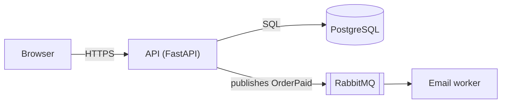
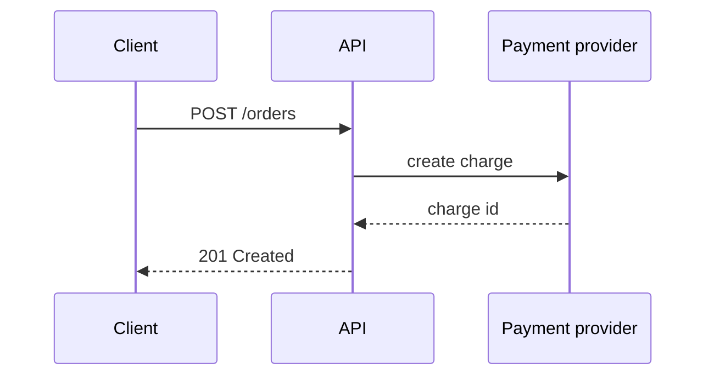

<!-- From agentic-defaults. Kit updates replace this file except a "## This project" section at the end, which belongs to the project. Edit nothing else. Rules for all work go in AGENTS.md "This project". -->

# Diagrams with Mermaid

Draw a diagram when it replaces several paragraphs: how components connect, how a request moves through the system, what the data model looks like, how something changes state. Don't draw what one sentence can say.

Write diagrams as `mermaid` code blocks inside the Markdown they explain: a `CONTEXT.md`, a plan or a pull request description. GitHub and GitLab render them, they diff like text, and people and agents can edit them. VS Code needs a Mermaid extension to preview them.

## Pick the type

| To show | Use |
|---|---|
| Components and how they connect, module dependencies, process steps | `flowchart` |
| Messages between parts over time, such as a request through services | `sequenceDiagram` |
| Data model and relationships | `erDiagram` |
| Lifecycle of one thing, such as an order going from placed to paid to shipped | `stateDiagram-v2` |
| Classes and interfaces, only when the design is strongly object-oriented | `classDiagram` |

## Rules

- **One idea per diagram, at most about 12 nodes.** Split bigger pictures: an overview in the root `CONTEXT.md`, and details next to the code they describe.
- **Use the real names from the code**, so readers can search for them.
- **Label the arrows** with what moves or happens: `HTTP`, `publishes OrderPaid`, `reads`.
- **Show external systems** (databases, queues, third-party APIs) as distinct nodes, for example inside a subgraph named `External`.
- **No colors or styling.** They break in dark mode and add nothing.
- **Keep diagrams current.** A diagram is part of the doc it sits in, so update it in the same change that makes it wrong.

## Syntax that breaks rendering

- Quote labels that contain punctuation: `A["Parse (v2)"]`, not `A[Parse (v2)]`.
- Don't use `end` as a node id in a flowchart; use `done` or `finish`.
- Keep node ids to letters, digits and underscores, and put the display text in the label: `order_svc["Order service"]`.
- Write subgraphs as `subgraph ext [External]` … `end`.
- Break lines inside a label with ` `.

## Check it

If the Mermaid CLI is installed (`mmdc`), render to a temporary folder to catch syntax errors: `mmdc -i doc.md -o /tmp/mermaid-check/doc.md`. Otherwise stick to the syntax shown here.

## Examples

