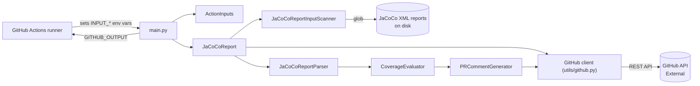

# jacoco-report

## Purpose

A GitHub composite Action that parses JaCoCo XML coverage reports and posts/updates a structured
coverage summary as a pull-request comment, evaluating configurable coverage thresholds and failing
the workflow run when they aren't met. For teams with JaCoCo-instrumented JVM builds (Maven/Gradle)
who want coverage visible directly in PR review, without digging through CI logs.

## Tech stack

- Python 3.11+ (CI matrix: 3.11, 3.12, 3.13, 3.14, 3.15 — only `unit-tests` runs the full matrix;
  `analysis`/`code-format-check`/`mypy-check`/`integration-tests`/`live-integration-test`/`self-test`
  run once on 3.11, the oldest supported version; `pyproject.toml`/`.pylintrc` target py311)
- No packaging layer: this is a GitHub composite Action (`action.yml`), not a pip package. Deps are
  pinned flat in `requirements.txt` (runtime) and `requirements-dev.txt` (`-r requirements.txt` plus
  dev tools); no `src/` layout.
- Libraries: `requests` (GitHub REST API), `pyyaml` (`report-groups` input parsing)
- Dev tooling: pylint, black (line-length 120), mypy, pytest + pytest-cov + pytest-mock
- CI: GitHub Actions (`.github/workflows/`); Renovate for dependency updates
- No database, no long-running process — runs once per workflow invocation and exits

## Structure

- `jacoco_report/` — the action's package: `action_inputs.py` (reads/validates every `INPUT_*` env
  var), `jacoco_report.py` (orchestrator, class `JaCoCoReport`), `scanner/` (glob-based XML
  discovery), `parser/` (JaCoCo XML → model), `evaluator/` (threshold evaluation), `generator/` (PR
  comment markdown), `model/` (data classes), `utils/` (GitHub API client, GH Actions I/O, enums,
  constants, logging)
- `main.py` — entry point: `ActionInputs` → `JaCoCoReport` → GH Action outputs/exit code
- `action.yml` — composite action definition: the real inputs/outputs contract; a `setup` step builds
  a venv under `$RUNNER_TEMP`, then the Run step runs `main.py` with that venv's interpreter
- `tests/unit/` — mirrors `jacoco_report/` package by package
- `tests/integration/` — full-pipeline tests against fixture XML in `tests/data/` and
  `tests/data_baseline/`, incl. golden snapshot tests (`tests/integration/fixtures/`) and a
  skip-unchanged × comment-level matrix; `tests/integration/live/` posts to a real PR (needs a GitHub
  token, skipped on forks)
- `docs/inputs/*.md` — one doc per action-input group, linked from `README.md`
- `.github/workflows/` — CI: static analysis & tests (incl. PR-only `context-check` and `self-test`;
  `self-test` runs the composite action itself via `uses: ./` on ubuntu and macos), release draft,
  link check, markdown lint, v2/v3 tag movers, Renovate, and `agd-update` (weekly `agd update`, opening a PR
  from the `agd-update` branch, as in agd's "Update automatically" guide; its unsigned push needs `agd-update`
  excluded from the "All Branches Rules" signed-commits ruleset, and opening the PR needs the repo setting
  "Allow GitHub Actions to create and approve pull requests"; checks start on that PR only after
  close/reopen, and it is merged by hand)
- `.claude/` (agents, skills), `.local_context/README.md` + `.gitignore`, and `AGENTS.md` above "This
  project" — the agentic-defaults kit, installed by `agd`; `.agd.lock` pins the kit version, packs and
  file hashes. Kit updates replace these files; don't hand-edit them (see `AGENTS.md` → "Kit files").

## How it fits together

`main.py` validates inputs, then `JaCoCoReport.run()` scans for JaCoCo XML files (per report-group if
configured), parses each with `JaCoCoReportParser` (cross-referencing the PR's changed files from the
GitHub API), evaluates coverage against thresholds with `CoverageEvaluator`, and renders/posts the PR
comment with `PRCommentGenerator`. Results and pass/fail are written back via `GITHUB_OUTPUT` and the
process exit code.

## Domain

- `ReportFileCoverage` — one parsed JaCoCo XML report: `overall_coverage` (`Coverage`) +
  `changed_files_coverage` (`dict[path, FileCoverage]`) + optional `group_name`.
- `Coverage` / `FileCoverage` — six JaCoCo counters each (`instruction`, `branch`, `line`,
  `complexity`, `method`, `clazz`), each a `Counter(missed, covered)` exposing `.coverage()` as a %.
- `ReportGroup` — a named set of path globs with optional per-group thresholds
  (`overall*changed*per-file`) and optional `baseline_paths`; a field falls back to
  `report-thresholds-default`, never to `global-thresholds`.
- `EvaluatedReportCoverage` — a report or group after threshold evaluation: reached %, threshold,
  pass/fail, per-changed-file pass map.
- Two independent threshold passes: **global** (`global-thresholds`: overall + changed-files-average,
  one evaluation across all reports/groups) and **per-report/group** (`report-thresholds-default` →
  group override, adds a per-changed-file check). They never fall back into each other.

## Contracts

- `action.yml` — the action's public interface (inputs/outputs/composite steps); source of truth for
  what callers configure. Kept in sync by hand with `README.md`'s Action Inputs table and
  `docs/inputs/*.md`.
- No OpenAPI/schema files. The only external contract is the GitHub REST API (PR files, issue
  comments), consumed through `jacoco_report/utils/github.py`.

## Running it

Commands are in `AGENTS.md` → "This project" (wrapped by the root `Makefile`). To run `main.py`
locally you need every `INPUT_*` env var set (see `DEVELOPER.md` → "Run Scripts Locally" for a
template script) plus GitHub-context vars (`GITHUB_REPOSITORY`, `GITHUB_EVENT_NAME=pull_request`,
`GITHUB_REF=refs/pull/<n>/merge`) and a real token to call the GitHub API. No database or other
service is needed.

## Conventions

- Logging only, never `print()`; log calls use lazy `%` formatting, not f-strings
  (`.github/copilot-instructions.md`).
- `tests/unit/test_no_direct_output.py` is an AST guard over `main.py` and `jacoco_report/`. It fails on: bare
  `print`/`pprint`; `sys.stdout`/`sys.stderr`/`__stdout__`/`__stderr__`; `from sys import stdout|stderr`;
  `traceback.print_*`; `os.write`; `sys.exit`/`exit`/`quit`/`SystemExit` with any argument that is not
  int-valued (int/bool constants, unary `+`/`-` on them, or an `IfExp` of those); `StreamHandler()` with no
  stream. Exempt as whole files: `utils/gh_action.py`, `utils/logging_config.py` (line-number allowlists
  would break on every edit).
- Every real input is read exclusively through `ActionInputs`
  (`jacoco_report/utils/gh_action.get_action_input`, `INPUT_`-prefixed env vars) — don't read
  `os.environ` elsewhere for inputs.
- Threshold strings are `*`-delimited: `global-thresholds` = `overall*changed-files-average`;
  `report-thresholds-default` / a group's `thresholds` = `overall*changed-files-average*per-changed-file`.
- No inline `# pylint: disable`; suppressions are centralized in `.pylintrc`'s `[MESSAGES CONTROL]`,
  each with a comment explaining why.
- `tests/` is excluded from pylint (`.pylintrc` `ignore-paths=tests`), mypy (`pyproject.toml`
  `exclude = "tests"`) and coverage (`omit = ["tests/*"]`).

## Key decisions

- `global-thresholds` and `report-thresholds-default`/group thresholds are intentionally two separate
  evaluation passes, not a fallback chain (repeated in comments across `coverage_evaluator.py` and
  `action_inputs.py`).
- `global-overall-scope: all` (default since v3) includes reports found by the top-level `paths` scan
  even when unmatched by any group, so the global number reflects the whole codebase;
  `groups-only` restores pre-v3 behaviour.
- Reports filtered out by `skip-unchanged` still count toward the informational overall-coverage total
  (issue #202), even though they're hidden from PR-comment rows.
- The venv is built per call in a fresh dir under `$RUNNER_TEMP` (see the `setup` invariant), not in the
  caller's workspace, so the checkout stays clean. Not a fixed path: reuse risks a stale `bin/python` after a
  Python switch and a venv planted by an earlier PR-code step. Accepted cost: reinstall on every call.
- Log injection is closed by one `WorkflowCommandSafeFormatter` on the log handler
  (`utils/logging_config.py`), which prefixes each continuation line with `| `, not by escaping at call
  sites: one place covers every log call and traceback, and intentional multi-line blocks stay readable.
  `::stop-commands::` was rejected: the formatter, the excepthooks and `captureWarnings` cover every channel.

## Invariants and gotchas

- `JaCoCoReportInputScanner.scan()` always returns forward-slash absolute paths
  (`_to_posix_abspath`), never OS-native separators — dev machines are both Windows and macOS, and
  this keeps results (and substring matching against them) identical on both.
- `JaCoCoReportParser` matches a changed file from the JaCoCo XML (`package`/`sourcefile`) against the
  PR's changed-file list by substring containment, after first trying to resolve it on disk via
  `os.walk` from the current working directory — ambiguous if a relative path repeats across modules.
- Pylint's real gate is `>=9.5` (`.pylintrc` `fail-under=9.5`, same number CI checks) — not 10/10.
- The `secrets` context is not allowed in a step- or job-level `if:`; GitHub rejects the whole workflow
  file as invalid and no job in it runs (issue #240: `renovate.yml` never auto-merged). Expose the
  secret via an `env:` var (e.g. `HAS_REVIEW_TOKEN: ${{ secrets.X != '' }}`) and test that instead.
- `action.yml` hands inputs to `main.py` only via the Run step's `env:` (`INPUT_<NAME>: ${{ inputs.<name> }}`,
  `-` → `_`, upper-cased) — a new input needs a line there and a `get_action_input` read in code.
- `action.yml` `run:` scripts contain no `${{ … }}` in any spelling: GitHub pastes expressions into the
  script before bash parses it, so an input there is shell injection. Use `$GITHUB_ACTION_PATH` and
  `$RUNNER_TEMP`, and quote every path. Enforced by `tests/unit/test_action_yml.py`.
- `inputs.token` may appear only in the Run step's `env.INPUT_TOKEN`. Never write `$GITHUB_ENV`: it leaks the token
  into the caller's later steps. Enforced by `tests/unit/test_action_yml.py`.
- Expression allowlist: the only `${{` outside the Run step's `env` is `setup`'s
  `env.INPUT_CA_BUNDLE: ${{ inputs.ca-bundle }}`. Each non-Run step's `env` equals its exact allowlist (`setup`:
  `{INPUT_CA_BUNDLE}`; others `{}`). The Run step's `${{` stay in its `env`. Enforced by
  `tests/unit/test_action_yml.py`.
- `action.yml` has exactly two steps: `setup` (`id: setup`, "Install Python dependencies") and the Run step.
  Composite steps get no `INPUT_*` vars, so `setup` gets `ca-bundle` only through its own `env`.
- `setup` runs every Python call with `-I`: the cwd is the caller's checkout, and a planted module there
  must not run. It picks the first of `python`, then `python3`, that is on PATH and is 3.11+
  (`$python_cmd`; `python` first keeps existing callers on their interpreter). It emits `::error::` and
  fails if neither is on PATH (with an `actions/setup-python` hint) or none is 3.11+. It creates
  `venv_dir="$(mktemp -d "${RUNNER_TEMP:-${TMPDIR:-/tmp}}/jacoco-report-venv.XXXXXX")"` per call with `"$python_cmd" -I -m venv` and
  writes that venv's `bin/python` to output `python`. The Run step gets it as `JACOCO_REPORT_PYTHON`
  (`steps.setup.outputs.python`). No `activate`, no `.venv`, nothing written into `GITHUB_WORKSPACE`.
- `setup` `-f` check (first, before any venv or pip): `INPUT_CA_BUNDLE` is trimmed of leading/trailing whitespace
  (incl. newlines) as in `ActionInputs.get_ca_bundle()`; whitespace-only counts as unset.
  If set and not a file, it emits
  `::error::` without the raw path and exits non-zero. When set, before pip: `export PIP_CERT=<path>` and
  `unset REQUESTS_CA_BUNDLE CURL_CA_BUNDLE` (step-local shell, never `$GITHUB_ENV`). Unset: pip's env is unchanged.
  Relative paths resolve from the workspace (same cwd as the Run step). `validate_inputs()` rejects a missing file too.
- The Run step runs `unset PYTHONPATH` then `"$JACOCO_REPORT_PYTHON" -B "$GITHUB_ACTION_PATH/main.py"`. Not `-I`:
  it implies `-P`, which drops `main.py`'s directory from `sys.path` and breaks `import jacoco_report`. The unset
  keeps a job-level `PYTHONPATH` from shadowing the venv. `-B` keeps `__pycache__` out of the action path and the
  caller checkout. Other `PYTHON*` variables (`PYTHONIOENCODING`, `PYTHONUTF8`) are honored.
- `setup_logging` (`utils/logging_config.py`) gives the root handler `WorkflowCommandSafeFormatter` and calls
  `basicConfig(force=True)` with no `format`/`datefmt` (the handler's formatter carries them), which removes any
  root handler set up earlier. The formatter prefixes each continuation line of a record with `| ` and rewrites
  legacy `##[` to `## [` via the shared `break_legacy_command_prefix` (`gh_action.py`): the runner's v1 parser
  finds `##[command]` anywhere in a line.
- `set_action_output` and `set_action_output_text` (`gh_action.py`) both write through `_write_action_output`: always
  a `name<<ghadelimiter_<uuid4>` heredoc with a random delimiter per call, never a fixed one. It raises `ValueError`
  if the name contains `\n` or `\r`.
- `tests/unit/test_ci_workflow.py` checks `.github/workflows/*.yml`:
  - Every third-party `uses:` is pinned to a full commit SHA with a `# vX.Y.Z` (or `# X.Y.Z`) comment. `docker://`
    actions are pinned by `@sha256:` digest with the same comment. Renovate config: `renovate.json` (`config:recommended`).
  - `static_analysis_and_tests.yml` only: no `run:` contains `${{` (context-check passes `github.base_ref` as
    `BASE_REF`); top-level `permissions` is read-only; every `actions/setup-python` step with `cache: pip` lists
    `requirements.txt` and `requirements-dev.txt` in `cache-dependency-path`.
  - `self-test` job: a local `uses: ./` run takes `steps.ca.outputs.path` (certifi); a `continue-on-error` run takes
    `ca-bundle` and its outcome is read through a step `env`.
- `setup_logging` also installs `sys.excepthook` and `threading.excepthook` (uncaught exceptions are logged through
  the formatter; exit code stays 1; `KeyboardInterrupt` goes to the default hook; thread `SystemExit` is ignored) and
  calls `logging.captureWarnings(True)`. These are process-wide: the autouse `tests/conftest.py` fixture
  `restore_process_hooks_after_test` restores both excepthooks and the warnings output after every test.
  `restore_root_logger_after_test` restores the root handlers and level and closes handlers a test added.
  `restore_environ_after_test` restores `os.environ` (e.g. `INPUT_DEBUG` set by a test); `tests/unit/test_env_isolation.py` pins it.
  The last two delegate to plain `snapshot_*`/`restore_*` helpers in `conftest.py`; tests call those helpers,
  never a fixture's `__wrapped__`.
- Runners: the `action.yml` scripts run on ubuntu and macos runners (`shell: bash`). Windows runners are not
  a support target (owner decision). This is about the runners callers use, not dev machines (see the
  `_to_posix_abspath` bullet). No `grep -P`.
- Dependencies: `requirements.txt` is runtime only (`requests`, `pyyaml`), and `action.yml`'s `setup` step
  installs it into callers' jobs. `requirements-dev.txt` starts with `-r requirements.txt`; `make setup` and
  the CI jobs that need dev tools install it. A new runtime import (anything `main.py` or `jacoco_report/`
  imports) must go in `requirements.txt`: otherwise the action breaks in callers' jobs while the tests still
  pass, because the dev install includes it.
- `set_action_failed` escapes each message with `escape_workflow_command_data` (`%`, `\r`, `\n`; `%`
  first, then `break_legacy_command_prefix`, as in the formatter bullet). Messages can contain text from PR report XMLs, so an unescaped newline could forge a workflow
  command such as `::add-mask::`. Any new `::command::` print must go through it.
- The `self-test` CI job runs on an ubuntu/macos matrix (`fail-fast: false`). It asserts exact
  action outputs (`coverage-overall` 91.62, 8 reports) computed from `tests/data/test_project/module_large/`
  + `context/**` fixture XMLs; editing those XMLs means updating the expected values in
  `static_analysis_and_tests.yml`. Its assertions use `jq`. Its `title` is hostile (`$(…)`, backticks), and it
  asserts the marker file `$RUNNER_TEMP/jacoco-pwned` was not created. It runs with `comment-level: none`
  + `update-comment: false` — the only mode that makes no comment API call — so it works on fork PRs.
  It also runs `ca-bundle` twice: certifi's bundle (must pass) and a missing path (`continue-on-error`).
  Before the missing-path run, a step records the count of `$RUNNER_TEMP/jacoco-report-venv.*` dirs; the assert step
  requires outcome `failure` AND an unchanged count (proves the failure came from the `setup` check, before any venv).
- GitHub Enterprise Server: the API base comes from `GITHUB_API_URL` (`ActionInputs.get_api_url`, passed into
  `GitHub(..., api_url)`), comment links (run link, changed-file links) from `GITHUB_SERVER_URL` (`get_server_url`, read
  in `PRCommentGenerator.__init__`). Both default to the github.com values when unset or blank; a trailing `/` is
  stripped. No hardcoded `Host` header (requests derives it from the URL). The "Generated by" link stays on
  github.com (`ACTION_REPOSITORY_URL`, the action's home).
- `GitHub` (`utils/github.py`) passes `verify=<path>` per request, only when `ca-bundle` is set. Reason: requests lets
  `REQUESTS_CA_BUNDLE`/`CURL_CA_BUNDLE` override `session.verify` but not a per-request `verify`. Unset → no `verify`
  kwarg (tests pin the exact call args).
- PR comment footer (`PRCommentGenerator._get_metadata_footer`): the action ref comes from `GITHUB_ACTION_PATH`
  (`.../_actions/<owner>/<repo>/<ref>`, `ActionInputs.get_action_ref`) because `GITHUB_ACTION_REF` is empty in
  composite steps (actions/runner#2473); `""` for a local `uses: ./`. `GITHUB_RUN_STARTED_AT` is not a GitHub default
  var, so the footer has no start time. The "Generated by" line always renders (never an empty footer).
- Every GitHub API call in `GitHub.send_request` passes `timeout=REQUEST_TIMEOUT` (`(10, 60)`, connect, read).
  A timeout is a `requests.RequestException`, so it surfaces as `None` like other request errors. There is
  deliberately no retry: a POST of a PR comment isn't idempotent (debt JR-04b). `get_comments` turns a failed
  page into the pages read so far (`[]` on page 1), which callers read as "no existing comment": with
  `update-comment: true` that adds a second comment instead of updating the first.

## Read more

- `docs/inputs/*.md` — one file per input group (paths, thresholds, report-groups, comment-level,
  skip-unchanged, baseline-paths, symbols-and-metric, pr-settings, debug, global-overall-scope, ca-bundle)
- `docs/v2-v3-migration-guide.md` — breaking changes v2 → v3, and the v3.4.0 caller-visible changes (section 8)
- `DEVELOPER.md` — local dev setup, running scripts/tests/lint, releasing
- `.github/copilot-instructions.md` — project-specific additions for Copilot, on top of `AGENTS.md`
