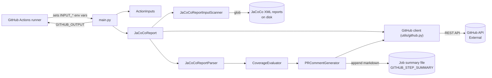

# jacoco-report

## Purpose

A GitHub composite Action that parses JaCoCo XML coverage reports and publishes a structured coverage
report as a pull-request comment and/or in the workflow run's job summary (`report-target`), evaluating
configurable coverage thresholds and failing the workflow run when they aren't met. For teams with
JaCoCo-instrumented JVM builds (Maven/Gradle) who want coverage visible directly in PR review, without
digging through CI logs.

## Tech stack

- Python 3.11+ (CI matrix: 3.11, 3.12, 3.13, 3.14, 3.15 — only `unit-tests` runs the full matrix;
  `analysis`/`code-format-check`/`mypy-check`/`integration-tests`/`live-integration-test`/`self-test`
  run once on 3.11, the oldest supported version; `pyproject.toml`/`.pylintrc` target py311)
- No packaging layer: this is a GitHub composite Action (`action.yml`), not a pip package. Runtime deps are
  declared in `requirements.in` and locked with hashes in `requirements.txt` (pip-compile output);
  `requirements-dev.txt` (`-r requirements.in` plus dev tools) is flat and unhashed; no `src/` layout.
- Libraries: `requests` (GitHub REST API), `urllib3` (its `Retry`, for GET retries), `pyyaml` (`report-groups`
  input parsing)
- Dev tooling: pylint, black (line-length 120), mypy, pytest + pytest-cov + pytest-mock
- CI: GitHub Actions (`.github/workflows/`); Renovate for dependency updates
- No database, no long-running process — runs once per workflow invocation and exits

## Structure

- `jacoco_report/` — the action's package: `action_inputs.py` (reads/validates every `INPUT_*` env
  var), `jacoco_report.py` (orchestrator, class `JaCoCoReport`), `scanner/` (glob-based XML
  discovery), `parser/` (JaCoCo XML → model), `evaluator/` (threshold evaluation; `baseline_comparison.py`:
  baseline matching and Δ; `baseline_verification.py`: the `baseline-sha` check), `generator/` (PR
  comment and job summary markdown), `model/` (data classes), `utils/` (GitHub API client, GH Actions I/O, enums,
  constants, logging)
- `main.py` — entry point: `ActionInputs` → `JaCoCoReport` → GH Action outputs/exit code
- `action.yml` — composite action definition: the real inputs/outputs contract; a `setup` step builds
  a venv under `$RUNNER_TEMP`, then the Run step runs `main.py` with that venv's interpreter
- `tests/unit/` — mirrors `jacoco_report/` package by package
- `tests/integration/` — full-pipeline tests against fixture XML in `tests/data/` and
  `tests/data_baseline/`, incl. golden snapshot tests (`tests/integration/fixtures/`; `snapshot_baseline_*` pin the Δ
  columns) and a
  skip-unchanged × comment-level matrix; `tests/integration/live/` posts to a real PR (needs a GitHub
  token, skipped on forks)
- `docs/inputs/*.md` — one doc per action-input group, linked from `README.md`
- `.github/workflows/` — CI: static analysis & tests (incl. PR-only `context-check` and `self-test`,
  `actionlint` (lints every workflow file and its `run:` scripts), and `ci-result`, the aggregated `CI result`
  check: see Key decisions; `self-test` runs the composite action itself via `uses: ./` on ubuntu), release draft,
  link check, markdown lint, v3 tag mover (`v2` is unmaintained, its tag frozen at `v2.1.3`), Renovate,
  and `agd-update` (weekly `agd update`, opening a PR
  from the `agd-update` branch, as in agd's "Update automatically" guide, but committing through the GraphQL
  `createCommitOnBranch` API, which GitHub signs, so the "All Branches Rules" signed-commits ruleset needs no
  exception; the commit is made on a temporary `agd-update-tmp-*` branch and `agd-update` then moves to it in
  one step, because a branch reset to `master` even for a moment makes GitHub close the open update PR; the
  API commit carries no file modes; opening the PR needs the repo and org setting "Allow GitHub Actions to
  create and approve pull requests"; GitHub holds the checks of that PR until someone clicks **Approve
  workflows to run**, and it is merged by hand)
- `.claude/` (agents, skills), `.local_context/README.md` + `.gitignore`, and `AGENTS.md` above "This
  project" — the agentic-defaults kit, installed by `agd`; `.agd.lock` pins the kit version, packs and
  file hashes. Kit updates replace these files; don't hand-edit them (see `AGENTS.md` → "Kit files").

## How it fits together

`main.py` validates inputs, then `JaCoCoReport.run()` scans for JaCoCo XML files (per report-group if
configured), parses each with `JaCoCoReportParser` (cross-referencing the PR's changed files from the
GitHub API), evaluates coverage against thresholds with `CoverageEvaluator`, and renders the report with
`PRCommentGenerator`, which writes it to the PR comment and/or the job summary (`report-target`). Results
and pass/fail are written back via `GITHUB_OUTPUT` and the process exit code.

## Domain

- `ReportFileCoverage` — one parsed JaCoCo XML report: `overall_coverage` (`Coverage`) +
  `changed_files_coverage` (`dict[path, FileCoverage]`) + optional `group_name`.
- `Coverage` / `FileCoverage` — six JaCoCo counters each (`instruction`, `branch`, `line`,
  `complexity`, `method`, `clazz`), each a `Counter(missed, covered)` exposing `.coverage()` as a %.
  Both are `@dataclass`es (value equality, unhashable). `FileCoverage` positional order: `file_name`,
  `file_path`, then the six counters (kept by the `_FileLocation` base listed second in `FileCoverage`).
- `ReportGroup` — a named set of path globs with optional per-group thresholds
  (`overall*changed*per-file`) and optional `baseline_paths`; a field falls back to
  `report-thresholds-default`, never to `global-thresholds`.
- `EvaluatedReportCoverage` — a report or group after threshold evaluation: reached %, threshold,
  pass/fail, per-changed-file pass map.
- Two independent threshold passes: **global** (`global-thresholds`: overall + changed-files-average,
  one evaluation across all reports/groups) and **per-report/group** (`report-thresholds-default` →
  group override, adds a per-changed-file check). They never fall back into each other.
- Baseline gate `no-decrease` (opt-in `fail-on-threshold` value, tolerance `max-decrease` in percentage points): a third
  check, against `baseline-paths` instead of a fixed minimum; overall coverage of the global row, groups and reports.

## Contracts

- `action.yml` — the action's public interface (inputs/outputs/composite steps); source of truth for
  what callers configure. Kept in sync by hand with `README.md`'s Action Inputs table and
  `docs/inputs/*.md`.
- No OpenAPI/schema files. The only external contract is the GitHub REST API (PR files, issue
  comments), consumed through `jacoco_report/utils/github.py`.

## Running it

Commands are in `AGENTS.md` → "This project" (wrapped by the root `Makefile`). To run `main.py`
locally you need every `INPUT_*` env var set (see `DEVELOPER.md` → "Run Scripts Locally" for a
template script) plus GitHub-context vars (`GITHUB_REPOSITORY`, `GITHUB_EVENT_NAME=pull_request`)
and a real token to call the GitHub API. The PR number comes from `INPUT_PR_NUMBER`, else a
`GITHUB_EVENT_PATH` payload with `pull_request.number`; `GITHUB_REF` is not read. No database or other
service is needed.

## Conventions

- Logging only, never `print()`; log calls use lazy `%` formatting, not f-strings
  (`.github/copilot-instructions.md`).
- `tests/unit/test_no_direct_output.py` is an AST guard over `main.py` and `jacoco_report/`. It fails on: bare
  `print`/`pprint`; `sys.stdout`/`sys.stderr`/`__stdout__`/`__stderr__`; `from sys import stdout|stderr`;
  `traceback.print_*`; `os.write`; `sys.exit`/`exit`/`quit`/`SystemExit` with any argument that is not
  int-valued (int/bool constants, unary `+`/`-` on them, or an `IfExp` of those); `StreamHandler()` with no
  stream. Exempt as whole files: `utils/gh_action.py`, `utils/logging_config.py` (line-number allowlists
  would break on every edit).
- Every real input is read exclusively through `ActionInputs`
  (`jacoco_report/utils/gh_action.get_action_input`, `INPUT_`-prefixed env vars) — don't read
  `os.environ` elsewhere for inputs.
- Threshold strings are `*`-delimited: `global-thresholds` = `overall*changed-files-average`;
  `report-thresholds-default` / a group's `thresholds` = `overall*changed-files-average*per-changed-file`.
  Each value is a float in `[0, 100]` (inclusive); validation in `action_inputs.py` (`_is_valid_threshold_float`).
  Parsing of the two top-level inputs goes through one function, `_parse_thresholds`: an input with no `*`
  falls back to its default, and a missing or empty part becomes `0.0`. A group's `thresholds` is parsed
  separately in `get_report_groups`, where an empty part becomes `None` so it falls back to `report-thresholds-default`.
- Input validation in `ActionInputs`: each input's checks live in their own `_validate_<input>() -> list[str]`
  (a report-group entry's: module-level `_validate_report_group_*` helpers). Error order = call order in
  `validate_inputs()`, pinned for every input by `test_validate_inputs_logs_errors_in_validation_order`; a new check
  goes in at the position where its error should appear. Inputs whose parsed value is logged go through
  `_read_or_record`, which records the getter's `ValueError` message and returns `None`. Threshold range errors come
  from `_threshold_range_errors`.
- Pylint suppressions come in two forms only, each with a comment giving the reason: a global entry in `.pylintrc`'s
  `[MESSAGES CONTROL]` for a rule disabled by design project-wide, or a class-level `# pylint: disable=<message>` for a
  single by-design exception (only `ActionInputs` → `too-many-public-methods`: one getter/validator per input).
- `too-many-arguments` is not suppressed (`max-args=8`; pylint doesn't count `self`). Values that travel together go
  in a frozen dataclass instead of separate parameters, e.g. `SummaryRow` (`reached`, `passed`, `threshold`), one row
  of the global summary table in `pr_comment_generator.py` (#271).
- `tests/` is excluded from pylint (`.pylintrc` `ignore-paths=tests`) and coverage
  (`omit = ["tests/*"]`), but not from mypy: `mypy .` (with `check_untyped_defs`) type-checks the tests
  too, so a patched method used as a mock needs a `cast(MagicMock, ...)` before `.call_args` and friends.
- Every `mocker` parameter in `tests/` is annotated `mocker: MockerFixture` (`.github/copilot-instructions.md`). A
  helper returning a `mocker.patch(...)` result is annotated `MockType` (from `pytest_mock`), not `MagicMock`:
  `patch` returns that union, and mypy rejects the narrower type.
- Code reads attributes of the project's own types directly: no defensive `getattr(obj, "x", default)` or
  `isinstance` fallbacks (#269); an optional object gets an explicit `is None` branch. A test passing a `Mock` in place
  of one of them (`CoverageEvaluator`, `JaCoCoReport`, `ReportGroup`) must set every attribute the code path reads: an
  unset `Mock` attribute is truthy and not a dict, so the code silently takes another branch (e.g.
  `PRCommentGenerator._has_baseline_data` then reports baseline data).
- `JaCoCoReport` builds every `CoverageEvaluator` through `_new_evaluator(reports, report_groups,
  report_thresholds_default)` (static) and copies results into `self.*` only through `_apply_results(evaluator,
  bs_evaluator, fail_unchanged_passed)` (#273). The caller reads `report-thresholds-default` once per path and passes
  it in: a two-part value is accepted but logs a warning on every read; the global thresholds are read inside the
  factory. A new action output set from an evaluator goes in `_apply_results`, so both the all-reports-unchanged path
  (`_handle_all_reports_filtered`) and the main path (`_evaluate_coverage`) set it. Each passes its own fail-unchanged
  result: `_handle_all_reports_filtered` checks every evaluated report, `_evaluate_coverage` only the filtered
  unchanged ones, read from `overall_evaluator`. With `evaluate_filtered_unchanged`, `_handle_all_reports_filtered`
  also collects the baseline (`_collect_baseline_reports`) and compares the filtered reports with it, as the main path
  does with `evaluate-unchanged`; without it nothing is evaluated and the deltas stay empty. Both paths build the
  baseline evaluator through `_new_baseline_evaluator`. A new output also goes in `_EXPECTED_OUTPUTS` of
  `tests/integration/test_unreadable_comments.py`, which pins the exact set of outputs written.
- `JaCoCoReport.run()` delegates in order. `_scan_reports(report_groups, global-overall-scope)` owns the top-level
  scan: ungrouped runs scan `paths` (or `DEFAULT_PATHS`), grouped runs scan `paths` only for scope `all`, else `[]`.
  `run()` then exits with "No input JaCoCo xml file found" when the ungrouped scan is empty, **before**
  `get_pr_changed_files` (that order is pinned by tests). `_parse_reports(parser, ...)` owns the per-group scan, the
  dedup by report path (first group wins) and the scope-`all` ungrouped append; it returns
  `(report_files_coverage, ungrouped_reports)`. `_split_unchanged_reports(reports, skip_unchanged,
  evaluate_filtered_unchanged)` (static) returns `(kept, filtered_unchanged)` and logs one line per filtered report;
  with skip-unchanged off it returns `(reports, [])`. If nothing is kept, `run()` calls
  `_handle_all_reports_filtered(gh, pr_number, parser, report_groups, filtered, evaluate_unchanged,
  fail_unchanged_enabled)` (it derives `evaluate_filtered_unchanged` itself) and returns. That ends in `_finish_all_filtered_output(gh, pr_number)`: for
  `summary`/`both` with `comment-level` ≠ `none` it writes `all_filtered_summary_body()` (title, the all-unchanged
  message, footer) to the job summary. `summary` then logs `SUMMARY_NO_COMMENT_INFO` and skips
  `_delete_stale_comment_if_update_enabled`; `comment`/`both` delete the stale comment when `update-comment` is true.
  Otherwise `_evaluate_coverage(parser, report_groups, kept, filtered, evaluate_unchanged, fail_unchanged_enabled)`
  owns the baseline collection (`_collect_baseline_reports(parser, report_groups)`, which hands grouped runs to
  `_collect_group_baseline_reports`: group inheritance of global `baseline-paths`, ambiguity skip, `[]` = disabled;
  called before the "Evaluating the coverage" log), the overall, results and baseline evaluators, fail-unchanged and
  `_apply_results`; it returns `(results evaluator, baseline evaluator)`. `run()` builds the `PRCommentGenerator` and
  passes it to `_report_generator_result(generator)`. The parser is built once in `run()` from the changed files and
  shared by the report and baseline parses. `run()` reads `report-groups` and `global-overall-scope` once and passes
  them in.
- Baseline Δ has one source, `BaselineComparison(evaluator, bs_evaluator)` (`evaluator/baseline_comparison.py`, #288):
  the generator renders it (comment and job summary); `_apply_results` stores the global one in
  `JaCoCoReport.total_coverage_delta`, whose properties `main.py` writes to the outputs
  `coverage-overall-delta`/`coverage-changed-files-delta`, and adds the `delta` key (`CoverageDelta.to_dict()`:
  `overall`, `changed_files`) to `reports-coverage`/`groups-coverage`, so all show the same numbers.
  - Matching: a report row takes the baseline report with its path, else the first with its name; global and group
    pair by path when any path matches, else by name. A group needs its name in the baseline's groups.
  - Every Δ is in percentage points, rounded to two decimals, `-0.0` turned into `0.0`. Report Δ = difference of the
    reached values. Global/group Δ = coverage of the reports now minus the same reports with each matched one's
    counters swapped for its baseline counters (unmatched count as unchanged); an empty current counter gives `0.0`.
    Rejected: the earlier `(covered now − covered baseline) / total now`, which is not percentage points once code
    is added (a drop from 80 % to 79.41 % showed as +0.98 %).
  - `None` = no baseline data or no matched report: the outputs are `""` (`main._delta_output`) and the entry has no
    `delta`, while the tables render `0.0%` (`_diffs_or_zero`). `0.0` in an output would read as "no drop".
  - The global Δ covers the results evaluator's reports, which with `skip-unchanged` and `evaluate-unchanged: false`
    leave out the filtered reports that `coverage-overall` still counts.
  - The generator builds the comparison per call (`_baseline()`), because tests replace `evaluator`/`bs_evaluator`
    after construction. `calculate_baseline_group_diffs` and `_calculate_baseline_report_diffs` stay on the generator
    as thin wrappers returning `(0.0, 0.0)` for no match; tests call them.
  - The `no-decrease` gate is `BaselineComparison.no_decrease_violations(max_decrease, unchanged_reports,
    match_evidence)`, called from `_apply_results` only when `no-decrease` is selected: `set_action_failed` prints violations as `::notice::` even when nothing
    fails, so always computing it would add messages for existing callers. It then sets
    `reached_threshold_no_decrease` and `self.violations = evaluator.violations + gate violations` (a new list; the
    evaluator's is not mutated). Order: global, groups, reports of the results evaluator, then `unchanged_reports`.
    With `baseline_verified is False` and baseline data, `_apply_results` skips the gate (INFO log), so the step passes
    (see Baseline verification).
  - When the results evaluator leaves the filtered unchanged reports out (`skip-unchanged`, `evaluate-unchanged:
    false`, so `evaluator_for_results is not overall_evaluator`), `_evaluate_coverage` passes their
    `overall_evaluator` rows on: with `fail-unchanged` as `unchanged_reports` (checked as report rows, as
    `fail-unchanged` checks their overall threshold), else as `match_evidence` (never checked, they only count as
    matches). The global and group rows keep the results evaluator's scope (the comment's Δ); neither list adds
    outputs.
  - The comment's row filter knows the gate too: with `no-decrease` selected, `PRCommentGenerator._dropped_row_keys`
    marks group/report rows that dropped (`BaselineComparison.group_dropped`/`report_dropped`, the gate's rule) as
    failing for `comment-level: failed`/`failed-or-changed`, else a row failing only the gate is hidden while the
    step fails. The Status column stays fixed-threshold; `get_max_decrease` is read only when `no-decrease` is on.
    An unverified baseline (`baseline_unverified`) makes `_dropped_row_keys` return empty.
  - Before the comment-level filter, rows whose changed files all have zero weight for the selected metric
    (`had_changed_files_before_filtering`) are hidden at every level, except rows that fail a fixed threshold or
    dropped (`_keep_zero_weight_rows_that_fail`; drops are computed before it). Such a kept row counts as changed
    for `changed`/`failed-or-changed` and renders its changed-files cells as `0.0%` ✅, like rows without data.
  - A row drops (`OverallChange.is_drop`) when its Δ (the rounded value the comment shows) is `< -max_decrease` and
    its missed count of the selected metric grew, so deleting covered code passes. Group/global counters come from
    `_aggregate_counters`, the same ones as the Δ; a report compares its own counters with its baseline report's.
    A report row's Δ is the difference of the rounded reached values (as the comment shows it), so it can be up to
    0.01 off the exact change: a 0.004 pp drop across a rounding step is `-0.01` and fails `max-decrease: 0.0`, while
    global/group rows round the exact change once.
  - No baseline data → only `NO_BASELINE_VIOLATION`, also when the baseline is unverified (owner decision: the
    verification only decides whether baseline data that was found comes from the base commit, it never excuses a
    missing one). `NO_MATCH_VIOLATION` (alone) only when no report of the run matches a baseline report: results
    evaluator, `unchanged_reports` and `match_evidence`. It is meant for misconfiguration (renamed `<title>`, wrong
    folder); counting the filtered reports keeps a PR that only adds a new module (no baseline yet) from failing. If
    only `unchanged_reports`/`match_evidence` matched, the global row is skipped with an INFO log. A group or report
    without a match is skipped with an INFO log. When skip-unchanged filters every report without evaluating them,
    `_apply_results` is not called and the gate passes. When it evaluates them only because of `fail-unchanged`
    (`evaluate-unchanged: false`), `_apply_results` gets `include_aggregate_rows=False`: report rows only, as for the
    filtered reports of a mixed run. A global row over unchanged reports can drop with every report row unchanged
    (stale baseline, report sizes changed). `max-decrease` is validated even when `no-decrease` is not selected.
- Baseline verification (`baseline-sha` + `baseline-metadata-path`, #290; `evaluator/baseline_verification.py`):
  - Inputs: both or neither (`ActionInputs._validate_baseline_verification`, run right after `max-decrease` in
    `validate_inputs()`); `baseline-sha` must be 40 or 64 hex characters (`_COMMIT_SHA_PATTERN`).
  - `JaCoCoReport._verify_baseline()` runs once per run, right after the PR number is logged, so the
    all-reports-filtered path is covered too. It sets `baseline_verified`: `None` (not configured), `True`, or `False`,
    and `main.py` writes `baseline-verified` as `""`/`true`/`false` (`main._verified_output`).
  - The file's `sha` is compared case-insensitively with the stripped `baseline-sha`. A mismatch or unusable file gives
    one `::warning::` (`print_action_warning`, which escapes it) with the reason, naming the path and, on a mismatch,
    both SHAs. The PR comment never contains the file's SHA.
  - The file is attacker-shaped data (any artifact producer chooses it): it is read as `utf-8-sig` and at most 65,536
    characters, `RecursionError` from `json.loads` counts as invalid JSON, and the file's `sha` is echoed only when it
    is a full commit SHA (`COMMIT_SHA_REGEX` in `constants.py`, shared with the input validation). A lone surrogate
    from JSON would otherwise make `print()` raise and crash the run. The check is consistency with the base commit,
    not authenticity: the docs' consumer example lists runs with `--event push` so a fork PR's run is never picked.
  - Unverified + baseline data: `no-decrease` is skipped, the Δ columns and `coverage-*-delta`/`delta` stay as they are,
    `_dropped_row_keys` is empty, and `UNVERIFIED_BASELINE_NOTE` is appended to the comment/summary head (after the
    basic table, never cut) when the Δ column shows.
  - One SHA and one metadata file cover the top-level and every group `baseline-paths`.
  - Reason (ticket #290): a baseline from another commit must not fail or pass a PR for reasons outside it, so it warns
    instead.
- A new `fail-on-threshold` value needs a `FailOnThresholdEnum` member, a `reached_threshold_*` flag on `JaCoCoReport`
  set in `_apply_results` and reset to False in `_mark_operational_failure`, and an entry in `main.py`'s
  `threshold_checks`.
- `run()` sits at the `too-many-locals` limit (`max-locals=20`, enabled; `self` counts): a new local there trips it,
  so new logic goes in a helper.
- `CoverageEvaluator` and `JaCoCoReport` sit at the `too-many-instance-attributes` limit (`max-attributes=15`): a new
  attribute trips it. `JaCoCoReport`'s Δ is one attribute, `total_coverage_delta: Optional[CoverageDelta]`;
  `total_overall_coverage_delta`/`total_changed_files_coverage_delta` are read-only properties over it (tests read
  them). Its other slot is `baseline_verified`.
  Its public result attributes are read by `PRCommentGenerator` and set directly by tests (`report_group_order`
  included), so keep them plain attributes. A group's threshold fallback (group field → `report-thresholds-default`)
  lives only in `_group_thresholds(group)`, used by `evaluate_group` and `_set_thresholds`.

## Key decisions

- `global-thresholds` and `report-thresholds-default`/group thresholds are intentionally two separate
  evaluation passes, not a fallback chain (repeated in comments across `coverage_evaluator.py` and
  `action_inputs.py`).
- `global-overall-scope: all` (default since v3) includes reports found by the top-level `paths` scan
  even when unmatched by any group, so the global number reflects the whole codebase;
  `groups-only` restores pre-v3 behaviour.
- Reports filtered out by `skip-unchanged` still count toward the informational overall-coverage total
  (issue #202), even though they're hidden from PR-comment rows.
- `report-target` default stays `comment`; `summary` is an optional second channel, not a new standard (owner
  decision). `summary` makes no comment API call, so it needs no write permission, and an existing comment is left
  as it is (not deleted).
- The venv is built per call in a fresh dir under `$RUNNER_TEMP` (see the `setup` invariant), not in the
  caller's workspace, so the checkout stays clean. Not a fixed path: reuse risks a stale `bin/python` after a
  Python switch and a venv planted by an earlier PR-code step. Accepted cost: reinstall on every call.
- Log injection is closed by one `WorkflowCommandSafeFormatter` on the log handler
  (`utils/logging_config.py`), which prefixes each continuation line with `| `, not by escaping at call
  sites: one place covers every log call and traceback, and intentional multi-line blocks stay readable.
  `::stop-commands::` was rejected: the formatter, the excepthooks and `captureWarnings` cover every channel.
- Dev pins stay unhashed on top of `-r requirements.in`: a single-platform pip-compile lock lacks Windows-only deps
  (e.g. `colorama` for pytest/pylint), which breaks Windows dev installs.
- `renovate.yml` gates on the PR's changed files, not on labels: Renovate adds labels after it opens the PR, so a
  label check races on `opened`.
- `renovate.yml` triggers on `pull_request`, not `pull_request_target`: GitHub blocks `pull_request_target` in public
  repos by default from 2026-12-02 (the run fails with an error annotation and runs no job). Renovate's branches live
  in this repo, so a `pull_request` run still gets the job's write token and `RENOVATE_REVIEW_TOKEN`. Costs: the job,
  including its `if` and `review-gate`, runs from the PR's merge commit, so a writer's push to the PR can change or
  drop them; a PR with a merge conflict gets no run, so the required check waits until Renovate rebases. Its job name
  `Auto-enable auto-merge for Renovate PRs` is a required check in the ruleset: renaming it leaves every PR waiting.
  `test_ci_workflow.py` fails on `pull_request_target` in any `*.yml` workflow. Rejected: allowing
  `pull_request_target` in an Actions event policy (a setting outside the repo and its tests).
- No `--only-binary=:all:` for pip: `--require-hashes` checks sdists too, but an sdist build's isolated env fetches
  build tools unhashed. pyyaml 6.0.3 has no cp315 or pure wheel, so 3.15 builds it. Rejected: it would break 3.15
  callers. Revisit when pyyaml ships cp315 wheels (#278).
- An incomplete `get_comments` read changes no comment, even if the existing comment was already found on an earlier
  page (#255). Acting on it would be safe only in that rare case (PRs with 100+ comments); one rule for both callers wins.
- `CI result` (job `ci-result` in `static_analysis_and_tests.yml`) is the check the ruleset is meant to require for
  the CI jobs, in place of `set-matrix`. Its `name` is a ruleset contract: renaming it leaves every PR waiting on a
  check that no longer exists. A test pins only `actionlint`'s place in `needs`; add each other new job there by hand.
  It fails on any needed `failure` or `cancelled`, and passes `skipped` (`self-test` and `live-integration-test` skip
  by design).
  `context-check` is excluded on purpose: `check.sh` is "a nudge, not a verdict", and `--strict` fails PRs that
  need no `CONTEXT.md` change. Owner merges bypass the ruleset (`bypass: always`), so the check gates Renovate
  auto-merge and contributors without bypass, not the owner. `support/2.1.x` is under the same ruleset and has
  no such job: after the swap, a PR to it without bypass waits forever, so add the job there before such a PR.

## Invariants and gotchas

- `JaCoCoReportInputScanner.scan()` always returns forward-slash absolute paths
  (`_to_posix_abspath`), never OS-native separators — dev machines are both Windows and macOS, and
  this keeps results (and path matching against them) identical on both.
- `JaCoCoReportParser` matches a changed file from the JaCoCo XML (`package`/`sourcefile`) against the
  PR's changed-file list on a directory boundary (`changed_file == key` or `changed_file.endswith("/" + key)`,
  `_matches_changed_file`), never by substring: `com/foo/Bar.java` must not match `src/xcom/foo/Bar.java`. The key
  is first resolved on disk: the first source file lookup walks `os.getcwd()` once, into a file-name → forward-slash
  relative-path index (`_index_workspace_files`) that the parser keeps for every report it parses (`.git` pruned,
  directory symlinks not followed). The index computes each directory's relative path once and appends file names
  to it: an `os.path.relpath` call per file makes the walk 1.6–2× slower on a large workspace. Candidates with the
  same file name pass the same boundary rule. Then they are narrowed to the report's module directory
  (`_report_module_directory`: the report path relative to `os.getcwd()`, cut at its first `target` or `build`
  directory segment, `""` at the root), so a report keeps only the sources under its own module. Matches are all
  kept when none lies under that directory (aggregate report), the report path has no `target`/`build` segment, or
  the report lies outside the working directory. No candidate → the key is the report's `<package>/<sourcefile>`
  path. A default-package source (`<package name="">`) gets the key `<file name>`, not `/<file name>`.
  It reads `<package>` at any depth (`root.iter`), not only under `<report>`: Maven `jacoco:report-aggregate`
  wraps each module in a `<group>`, and groups can nest. `<group>` names are not used. A direct-children-only
  lookup finds no changed files in such reports, so the changed-file checks pass without checking anything.
  Fixture: `tests/data/report_aggregate/` (kept outside `test_project/`, which the self-test and snapshots scan).
- Pylint's gate is zero messages: `.pylintrc` `fail-under=10`; CI runs pylint and uses its exit code, not a score.
- `make lint`, `make format`, `make build` and the black step of `make check` take `$(git ls-files '*.py')`: a new
  untracked `.py` file is not linted, formatted or compiled until it is `git add`ed. pytest and `mypy .` still see it.
- The `secrets` context is not allowed in a step- or job-level `if:`; GitHub rejects the whole workflow
  file as invalid and no job in it runs (issue #240: `renovate.yml` never auto-merged). Expose the
  secret via an `env:` var (e.g. `HAS_REVIEW_TOKEN: ${{ secrets.X != '' }}`) and test that instead.
- `action.yml` hands inputs to `main.py` only via the Run step's `env:` (`INPUT_<NAME>: ${{ inputs.<name> }}`,
  `-` → `_`, upper-cased) — a new input needs a line there and a `get_action_input` read in code.
- `action.yml` `run:` scripts contain no `${{ … }}` in any spelling: GitHub pastes expressions into the
  script before bash parses it, so an input there is shell injection. Use `$GITHUB_ACTION_PATH` and
  `$RUNNER_TEMP`, and quote every path. Enforced by `tests/unit/test_action_yml.py`.
- `inputs.token` may appear only in the Run step's `env.INPUT_TOKEN`. Never write `$GITHUB_ENV`: it leaks the token
  into the caller's later steps. Enforced by `tests/unit/test_action_yml.py`.
- `token` is optional with `default: ${{ github.token }}` (#286). An explicit value, even an empty one (e.g. a secret
  that doesn't exist), replaces the default, and `_validate_token` then fails the run. Python has no default of its
  own for it: a local run must set `INPUT_TOKEN`.
- Expression allowlist: in `runs.steps`, the only `${{` outside the Run step's `env` is `setup`'s
  `env.INPUT_CA_BUNDLE: ${{ inputs.ca-bundle }}`. Each non-Run step's `env` equals its exact allowlist (`setup`:
  `{INPUT_CA_BUNDLE}`; others `{}`). The Run step's `${{` stay in its `env`. Enforced by
  `tests/unit/test_action_yml.py`. Outside `runs.steps` there are only the `token` default and the `outputs.*.value`
  step-output references (no test pins this part).
- `action.yml` has exactly two steps: `setup` (`id: setup`, "Install Python dependencies") and the Run step.
  Composite steps get no `INPUT_*` vars, so `setup` gets `ca-bundle` only through its own `env`.
- `setup` runs every Python call with `-I`: the cwd is the caller's checkout, and a planted module there
  must not run. It picks the first of `python`, then `python3`, that is on PATH and is 3.11+
  (`$python_cmd`; `python` first keeps existing callers on their interpreter). It emits `::error::` and
  fails if neither is on PATH (with an `actions/setup-python` hint) or none is 3.11+. It creates
  `venv_dir="$(mktemp -d "${RUNNER_TEMP:-${TMPDIR:-/tmp}}/jacoco-report-venv.XXXXXX")"` per call with `"$python_cmd" -I -m venv` and
  writes that venv's `bin/python` to output `python`. The Run step gets it as `JACOCO_REPORT_PYTHON`
  (`steps.setup.outputs.python`). No `activate`, no `.venv`, nothing written into `GITHUB_WORKSPACE`.
- `setup` `-f` check (first, before any venv or pip): `INPUT_CA_BUNDLE` is trimmed of leading/trailing whitespace
  (incl. newlines) as in `ActionInputs.get_ca_bundle()`; whitespace-only counts as unset.
  If set and not a file, it emits
  `::error::` without the raw path and exits non-zero. When set, before pip: `export PIP_CERT=<path>` and
  `unset REQUESTS_CA_BUNDLE CURL_CA_BUNDLE` (step-local shell, never `$GITHUB_ENV`). Unset: pip's env is unchanged.
  Relative paths resolve from the workspace (same cwd as the Run step). `validate_inputs()` rejects a missing file too.
- The Run step runs `unset PYTHONPATH` then `"$JACOCO_REPORT_PYTHON" -B "$GITHUB_ACTION_PATH/main.py"`. Not `-I`:
  it implies `-P`, which drops `main.py`'s directory from `sys.path` and breaks `import jacoco_report`. The unset
  keeps a job-level `PYTHONPATH` from shadowing the venv. `-B` keeps `__pycache__` out of the action path and the
  caller checkout. Other `PYTHON*` variables (`PYTHONIOENCODING`, `PYTHONUTF8`) are honored.
- `setup_logging` (`utils/logging_config.py`) gives the root handler `WorkflowCommandSafeFormatter` and calls
  `basicConfig(force=True)` with no `format`/`datefmt` (the handler's formatter carries them), which removes any
  root handler set up earlier. The formatter prefixes each continuation line of a record with `| ` and rewrites
  legacy `##[` to `## [` via the shared `break_legacy_command_prefix` (`gh_action.py`): the runner's v1 parser
  finds `##[command]` anywhere in a line.
- `set_action_output` and `set_action_output_text` (`gh_action.py`) both write through `_write_action_output`: always
  a `name<<ghadelimiter_<uuid4>` heredoc with a random delimiter per call, never a fixed one. It raises `ValueError`
  if the name contains `\n` or `\r`.
- `tests/unit/test_ci_workflow.py` checks `.github/workflows/*.yml`:
  - Every third-party `uses:` is pinned to a full commit SHA with a `# vX.Y.Z` (or `# X.Y.Z`) comment. `docker://`
    actions are pinned as `image:tag@sha256:<digest>` with no comment: for a digest-only image Renovate looks up
    `latest` (fails when the image has none), and it rewrites only the image reference, so a comment would go stale.
    Renovate config: `renovate.json` (`config:recommended`).
  - `static_analysis_and_tests.yml` only: no `run:` contains `${{` (context-check passes `github.base_ref` as
    `BASE_REF`); top-level `permissions` is read-only; every `actions/setup-python` step with `cache: pip` lists
    `requirements.txt` and `requirements-dev.txt` in `cache-dependency-path`.
  - `self-test` job: a local `uses: ./` run takes `steps.ca.outputs.path` (certifi); a `continue-on-error` run takes
    `ca-bundle` and its outcome is read through a step `env`. The `report-target: summary` run is read the same way and
    compared with `success`
    (`test_self_test_runs_report_target_summary_with_default_update_comment_and_asserts_its_outcome`).
  - `actionlint` job (`static_analysis_and_tests.yml`): no `if:`, `docker://rhysd/actionlint:<tag>@sha256:` pin, listed in
    `ci-result.needs` (`test_actionlint_runs_on_every_event_and_gates_ci_result`). A workflow actionlint rejects fails
    `CI result`, and so does any shellcheck finding (its bundled shellcheck, `info` level included): new `run:` scripts
    must be shellcheck-clean or carry `# shellcheck disable=SCxxxx # reason`. actionlint does not check `action.yml`;
    `tests/unit/test_action_yml.py` runs shellcheck (`--norc`, all severities) on every `action.yml` `run:` script. It
    skips locally when shellcheck is absent and fails in CI (`GITHUB_ACTIONS=true`).
- `setup_logging` also installs `sys.excepthook` and `threading.excepthook` (uncaught exceptions are logged through
  the formatter; exit code stays 1; `KeyboardInterrupt` goes to the default hook; thread `SystemExit` is ignored) and
  calls `logging.captureWarnings(True)`. These are process-wide: the autouse `tests/conftest.py` fixture
  `restore_process_hooks_after_test` restores both excepthooks and the warnings output after every test.
  `restore_root_logger_after_test` restores the root handlers and level and closes handlers a test added.
  `restore_environ_after_test` restores `os.environ` (e.g. `INPUT_DEBUG` set by a test); `tests/unit/test_env_isolation.py` pins it.
  The last two delegate to plain `snapshot_*`/`restore_*` helpers in `conftest.py`; tests call those helpers,
  never a fixture's `__wrapped__`.
- Runners: the `action.yml` scripts run on ubuntu runners (`shell: bash`). macOS and Windows runners are not a support
  target (owner decision); no code blocks them. This is about the runners callers use, not dev machines (see the
  `_to_posix_abspath` bullet). No `grep -P`.
- Dependencies: `requirements.in` holds the runtime top-level pins (`requests`, `pyyaml`, and `urllib3`, also a
  `requests` dependency but imported directly). `requirements.txt` is
  its lock (`--generate-hashes`); `action.yml`'s `setup` installs it into callers' jobs with `--require-hashes`.
  Never hand-edit `requirements.txt`: regenerate it with the command in its header (`DEVELOPER.md` → "Update
  Dependencies"). `requirements-dev.txt` starts with `-r requirements.in`; `make setup` and the CI jobs that need
  dev tools install it. A new runtime import (anything `main.py` or `jacoco_report/` imports) must go in
  `requirements.in` and the lock must be regenerated: otherwise the action breaks in callers' jobs while the tests
  still pass, because the dev install includes it.
- `set_action_failed` and `print_action_warning` (`::warning::`, no exit) escape each message with
  `escape_workflow_command_data` (`%`, `\r`, `\n`; `%` first, then `break_legacy_command_prefix`, as in the formatter
  bullet). Messages can contain text from PR report XMLs, so an unescaped newline could forge a workflow command such
  as `::add-mask::`. Any new `::command::` print must go through it.
- The `self-test` CI job runs on ubuntu. It asserts exact
  action outputs (`coverage-overall` 91.62, 8 reports) computed from `tests/data/test_project/module_large/`
  + `context/**` fixture XMLs; editing those XMLs means updating the expected values in
  `static_analysis_and_tests.yml`. Its assertions use `jq`. Its `title` is hostile (`$(…)`, backticks), and it
  asserts the marker file `$RUNNER_TEMP/jacoco-pwned` was not created. Its first run uses `comment-level: none`
  + `update-comment: false`, which makes no comment API call, and passes no `token`: it is the only check that the
  `github.token` default reaches the action. The other runs pass `token` explicitly. A second run uses `report-target: summary`
  (`comment-level: full`, default `update-comment`, title `Self-test job summary`, `continue-on-error: true`), which
  makes no comment API call either. Its assert step reads the outcome through `env`, requires `success`, and checks
  the same coverage outputs as the first run. Each step gets its own job summary file, so the summary's content is checked by
  hand in the run's UI.
  The first run also sets `baseline-paths: tests/data_baseline/test_project/**/jacoco.xml` and asserts
  `coverage-overall-delta` 4.85, `coverage-changed-files-delta` 0.0 (the PR's changed files are not Java), 4 entries
  with `delta` (matched by name; `user-info:  Controller Module Report` has a double space in the current fixture,
  so it does not match) and Module Large's `delta.overall` −4.17. The summary run has no baseline and asserts empty
  deltas. Editing `tests/data_baseline/` means updating those values too.
  It also runs `ca-bundle` twice: certifi's bundle (must pass) and a missing path (`continue-on-error`).
  Before the missing-path run, a step records the count of `$RUNNER_TEMP/jacoco-report-venv.*` dirs; the assert step
  requires outcome `failure` AND an unchanged count (proves the failure came from the `setup` check, before any venv).
- GitHub Enterprise Server: `get_api_url()` / `get_server_url()` in `utils/github.py` read the runner default variables
  `GITHUB_API_URL` / `GITHUB_SERVER_URL` (not action inputs, deliberately not on `ActionInputs`). The API base goes into
  `GitHub(..., api_url)` from `JaCoCoReport.run`; the server URL is read in `PRCommentGenerator.__init__` for the run and
  changed-file links. github.com fallbacks apply only when unset or empty (local runs, tests). No hardcoded `Host`
  header. The "Generated by" link stays on github.com.
- The PR number has one source: `ActionInputs.get_pr_number()`, resolved once in `JaCoCoReport.run()` and passed to
  every GitHub call that needs it (`get_pr_changed_files`, `get_comments`, `add_comment`). Nothing reads `GITHUB_REF`,
  so changed files and the comment always come from the same PR.
- `GitHub` (`utils/github.py`) passes `verify=<path>` per request, only when `ca-bundle` is set. Reason: requests lets
  `REQUESTS_CA_BUNDLE`/`CURL_CA_BUNDLE` override `session.verify` but not a per-request `verify`. Unset → no `verify`
  kwarg (tests pin the exact call args).
- `report-target` (`ReportTargetEnum`: `comment` default, `summary`, `both`): `ActionInputs.get_report_target()` strips
  and lower-cases, empty → `comment`. `_validate_report_target()` runs right after `_validate_comment_level()`.
  - `comment-level` decides the content for both channels; `none` writes nothing to the job summary either. Thresholds,
    outputs and job result never depend on the target.
  - `GITHUB_STEP_SUMMARY` is a runner variable, not an input. Only `gh_action.get_step_summary_path()` reads it, and
    only through `write_job_summary(target, body)`, which is called only when the target is not `comment`.
  - `gh_action.append_step_summary(path, text) -> bool` appends exactly `text` as UTF-8, with no added newline, so a
    body cut to the limit stays within it. An `OSError` is logged with `exc_info` and returns False.
  - `write_job_summary` returns `None` when written, else the warning text for the caller: the variable unset or empty
    (`SUMMARY_NOT_SET_WARNING`), or the write failed (`SUMMARY_WRITE_FAILED_WARNING`). Nothing in `gh_action` or the
    generator prints it; `JaCoCoReport` prints it with `print_action_warning`. A summary problem never changes the job
    result or outputs.
- `pr_comment_generator.py` is close to pylint's `max-module-lines=1000`. Move the cut/body helpers (`_CutRules`,
  `_fit_to_limit` and friends) to their own module before adding more. A moved helper reads its limit and logs through
  its own module, so tests that patch `MAX_COMMENT_LENGTH` / `MAX_SUMMARY_BYTES` on `pr_comment_generator` and filter
  `caplog` by its logger name must be retargeted.
- PR comment footer (`_metadata_footer(server_url, repository)`, module-level): the action ref comes from
  `GITHUB_ACTION_PATH` (`.../_actions/<owner>/<repo>/<ref>`, `ActionInputs.get_action_ref`) because
  `GITHUB_ACTION_REF` is empty in composite steps (actions/runner#2473); `""` for a local `uses: ./`.
  `GITHUB_RUN_STARTED_AT` is not a GitHub default var, so the footer has no start time. The "Generated by" line
  always renders (never an empty footer).
- Report length limits, one cut algorithm for both channels (`pr_comment_generator.py`):
  - Comment: `GITHUB_COMMENT_LIMIT = 65_536` (GitHub's limit); `MAX_COMMENT_LENGTH` is the cap checked (tests lower
    it). Measured with `len()` (code points).
  - Job summary: `GITHUB_SUMMARY_LIMIT = MAX_SUMMARY_BYTES = 1_048_576`, measured in UTF-8 bytes (tests lower
    `MAX_SUMMARY_BYTES`). It is cut only at this limit, never at the comment limit.
  - `_get_comment_content(comment_level)` returns `(title, _ReportParts(head, sections, footer))`. `_fit_to_limit(parts,
    rules)` returns the body unchanged when it is within `rules.limit`; `_render_body(parts, keep, rules)` joins the
    parts with `keep` rows; `_log_cut(parts, keep, body, rules)` logs. `rules` is a frozen `_CutRules` built by
    `_comment_rules(summary_written, run_url)` or `_summary_rules(run_url)`. Limits are read at call time.
  - Parts: head = title + basic table (+ "No rows match the selected comment level." when no detail table; never cut).
    Cuttable sections, in order: detail tables (groups, reports, changed files), then the ungrouped-reports warning.
    Tail = metadata footer only. Joined by `\n\n`.
  - Section shapes: table = 2 header lines + `|` rows; a table whose lines after the header are not all `|` rows is
    never cut. Ungrouped warning = frame before the `- ` items, the items, frame after (Hint, `
`); its frame
    stays even when all items are cut (the summary keeps the count).
  - Only rows are cut. Title, basic table, no-rows line and footer are always kept; the title stays first
    (`update-comment` finds the comment by `startswith(title)`).
  - Rows are kept in document order: the largest leading count across all sections that fits (binary search). No
    ranking. Cut from the end: ungrouped items first, then changed-file rows, report rows, group rows. A row is never
    split. A table with all rows cut is dropped with its header.
  - Names in rows (changed-file names, report names, group names, ungrouped-report paths) get `\r`/`\n` replaced by a
    space (`_single_line`), so each row is one line.
  - Note paragraph, placed just before the footer. Comment: `… N row(s) omitted (GitHub's 65,536-character comment
    limit), see the job log.` (`comment`, or `both` when the summary was not written); `see the [job summary](<run
    URL>).` (`both` with the summary written). Job summary: `… N row(s) omitted (GitHub's 1 MiB job summary limit), the
    full report is in the [job log](<run URL>).` The run URL is `_run_url`, the footer's run URL; without a run id or
    repository the note has no link.
  - Log (`logger`). Comment: one `warning` (body length, limit, rows omitted), then one `info` (`Omitted from the PR
    comment:`) per cut section: its 2 header lines and its omitted rows; ungrouped items use `Reports not assigned to
    any group:`. Job summary: one `warning`, then one `info` (`Full report (job summary was cut):`) with the whole
    uncut body; omitted rows are not logged separately. Rows can carry PR file names, so they go through
    `WorkflowCommandSafeFormatter`.
  - Backstop: only if the fixed parts (title, basic table, frames, note, footer; e.g. an absurdly long `title`) still
    exceed the limit, the body is cut to the limit (`MAX_COMMENT_LENGTH` characters, or `MAX_SUMMARY_BYTES` bytes,
    never splitting a UTF-8 character; a character cut may end mid-line, no longer valid markdown) and a second
    `warning` is logged.
  - Reason for cutting from the end: the issue asks for a row-boundary cut, and the aggregate tables matter more than
    per-file rows. Other options rejected: hard cut of the string (breaks tables, loses the count); renderers
    returning row lists (larger refactor of 5 renderers for the same result).
- Every GitHub API call in `GitHub.send_request` passes `timeout=REQUEST_TIMEOUT` (`(10, 60)`, connect, read).
  A timeout is a `requests.RequestException`, so it surfaces as `None` like other request errors.
  - Only GET is retried (#256, debt JR-04b): `_GetOnlyRetry` on an `HTTPAdapter` mounted for `https://` and `http://`.
    3 retries, `backoff_factor=1` (sleeps 0, 2, 4 s), statuses 429/500/502/503/504, `Retry-After` honoured up to
    `retry_after_max=60` s, `raise_on_status=False` (the last response reaches `raise_for_status`). Each retry logs a
    warning. Estimate per GET call (each page), if every attempt ends at its timeout: 4 attempts × 70 s
    (`REQUEST_TIMEOUT`) + 3 waits ≤ 60 s = 460 s; all timeouts, no `Retry-After`: 4 × 70 + 6 = 286 s. Not a hard
    limit: the 60 s read timeout bounds each gap between socket reads, not the whole download, so a server or proxy
    that trickles bytes can keep one attempt going longer.
  - The retries end when the response headers arrive: requests reads the body afterwards, outside urllib3's retry
    loop, so a GET whose body download fails (reset, timeout) is not retried (#303).
  - POST/PATCH/DELETE are sent once: a repeated POST can post the comment twice. `allowed_methods` alone doesn't
    ensure it: urllib3 repeats connect and other errors (e.g. an SSL error after the request was sent) for any
    method, so `_GetOnlyRetry.increment` fails a non-GET as requests' default `Retry(0, read=False)` does.
  - Failed HTTP status hints (#257): directly after the `HTTP error occurred` ERROR line (and its traceback),
    `_hint_for_http_error` logs one more `Hint: ...` ERROR line for 401 (token invalid/expired), 403 (missing
    permission; the hint says `report-target: summary` shows the report without write permission) or 404 (no access,
    or wrong `GITHUB_API_URL` on GHES). Callers
    may log more after it. 403 with `X-RateLimit-Remaining: 0` gets the rate-limit hint instead. Static text from module constants: no token, URL or body. No hint for 5xx, 422,
    other statuses, or `HTTPError` without a response. No extra API call.
  `get_comments` returns `None` when a read is incomplete; both callers then make no comment change. With
  `update-comment: false` the generator doesn't read comments at all.
  - `PRCommentGenerator.generate()` writes the job summary first (target ≠ `comment`, via `_write_summary`), then the
    comment. It sets `summary_written` and `summary_warning` and prints nothing. It returns `bool`: True when no comment
    operation failed (incl. nothing to do: `comment-level: none` + `update-comment: false`), False on an unreadable
    read or a failed add/update/delete.
  - Target `summary`: after the summary it logs `SUMMARY_NO_COMMENT_INFO` at INFO and returns True before any comment
    read, so it makes no comment API call (no GET, POST, PATCH or DELETE).
  - `JaCoCoReport._report_generator_result` prints `summary_warning`, then `PR_COMMENT_MAY_BE_STALE_WARNING` when the
    result is False. It logs `PR comment(s) generated successfully.` only when the target is not `summary`.
  - `update_comment` returns False, never raises, on an unusable 2xx response (non-JSON body, no `body` key, or JSON
    that isn't an object), logged with `logger.error`. A body mismatch also returns False.
  - `JaCoCoReport` owns the warning (`PR_COMMENT_MAY_BE_STALE_WARNING`, `print_action_warning`; text says the comment
    *may* not have been changed, since a timed-out or mismatched write can still have changed it): one per run at the
    end of `run` on False (the success line is logged only on True), and in `_delete_stale_comment_if_update_enabled`
    on an unreadable read or a failed delete (no `Deleted stale` line). Job result and outputs are unchanged.
- Runtime deps (`requirements.in`, `requirements.txt`) never automerge. Three controls, all required:
  - `renovate.json`: the `pip-compile` rule for those two files sets `automerge: false`; `pip_requirements` is
    disabled for `requirements.txt`; `pip-compile` `managerFilePatterns` matches `requirements.txt` only;
    `lockFileMaintenance` is enabled (its PRs are reviewed too). The runtime rule has `minimumReleaseAge: "7 days"`:
    a runtime PR opens only once the release is 7 days old. Vulnerability-fix PRs skip the wait (`vulnerabilityAlerts`
    sets no `minimumReleaseAge`); lock file maintenance does not wait (`--upgrade` takes the latest version).
  - `.github/workflows/renovate.yml`: step `review-gate` reads the PR's changed files from the GitHub API into a
    variable first. If `requirements.in`, `requirements.txt` or any file under `.github/workflows/` changed, it sets
    `review-required=true`, and the PAT approval and `gh pr merge --auto` steps are skipped; the job stays green. A
    failed or empty file list fails the step, so nothing is approved or merged. The job is a required status check,
    so it must still succeed on those PRs. The gate holds against Renovate, not against a writer: it runs from the
    PR's merge commit, so a writer's push can change it.
  - `.github/CODEOWNERS`: `*`, `/requirements.in` and `/requirements.txt` belong to the owner; `/requirements-dev.txt`
    is unowned; a test pins that set. `RENOVATE_REVIEW_TOKEN` is a classic PAT (`public_repo`) of a dedicated bot
    account (outside collaborator, write access, not a code owner), so its approval meets the one required approval
    but never code-owner review. Classic because an outside collaborator can't use a fine-grained PAT on an org repo;
    org membership was rejected because the org's base permission would open its private repos to the bot. Every
    writer can read repo secrets, so the token must never belong to a code owner. An expired or revoked token fails
    the approve step, so the required check fails on every ungated Renovate PR. Residual risk: any writer can get a
    PR that changes only unowned files (`requirements-dev.txt`, any update type) merged without the owner, approved
    with this token or with `GITHUB_TOKEN` (the repo lets Actions approve PRs; `agd-update.yml` needs that setting
    to open its PR).
- Workflow-file PRs (any change under `.github/workflows/`) never automerge either, via the same `review-gate`.
  - Gate covers all of `.github/workflows/`, not a list of workflows: a list goes stale, and the workflows holding
    secrets are not only those with write access. Cost: about 2 manual merges a month.
  - `github-actions` rule in `renovate.json` sets `minimumReleaseAge: "7 days"`. It is the only control for the
    pre-merge exposure: Renovate branches live in this repo, so `pull_request` workflows run the new action version
    with `secrets.TOKEN` when the PR opens (`lycheeverse/lychee-action`, `AbsaOSS/release-notes-presence-check`).
    A merge gate cannot stop this.
  - Known limits: vulnerability-fix PRs skip the wait; a compromise unnoticed for over 7 days still reaches
    `secrets.TOKEN`; the delay detects nothing, and a GitHub tag's age comes from its commit or tagger date, which
    an attacker can backdate.
  - Rejected: binding approval or auto-merge to the head SHA (a race of seconds, needs a push to Renovate's branch).
- Only the Renovate app and admins can create or update `renovate/**`: ruleset "Renovate branches" (rules `creation`
  and `update`; bypass: the Renovate app, id 2740, and the admin role). `renovate.yml`'s `if` checks the PR author,
  not the pusher, so without it a writer's commit on a Renovate branch gets the job's approval and auto-merge.
  Deletion stays open: GitHub deletes merged head branches. It lives in repo settings; no test sees it.

## Read more

- `docs/inputs/*.md` — one file per input group (paths, thresholds, report-groups, comment-level,
  report-target, skip-unchanged, baseline-paths, symbols-and-metric, pr-settings, debug, global-overall-scope,
  ca-bundle)
- `docs/v2-v3-migration-guide.md` — breaking changes v2 → v3, and the v3.4.0 caller-visible changes (section 8)
- `DEVELOPER.md` — local dev setup, running scripts/tests/lint, releasing
- `.github/copilot-instructions.md` — project-specific additions for Copilot, on top of `AGENTS.md`
