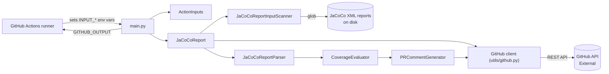

# jacoco-report

## Purpose

A GitHub composite Action that parses JaCoCo XML coverage reports and posts/updates a structured
coverage summary as a pull-request comment, evaluating configurable coverage thresholds and failing
the workflow run when they aren't met. For teams with JaCoCo-instrumented JVM builds (Maven/Gradle)
who want coverage visible directly in PR review, without digging through CI logs.

## Tech stack

- Python 3.11+ (CI matrix: 3.11, 3.12, 3.13, 3.14; `pyproject.toml`/`.pylintrc` target py311)
- No packaging layer: this is a GitHub composite Action (`action.yml`), not a pip package. Deps are
  pinned flat in `requirements.txt` (`requests`, `pyyaml`, dev tools); no `src/` layout.
- Libraries: `requests` (GitHub REST API), `pyyaml` (`report-groups` input parsing)
- Dev tooling: pylint, black (line-length 120), mypy, pytest + pytest-cov + pytest-mock
- CI: GitHub Actions (`.github/workflows/`); Renovate for dependency updates
- No database, no long-running process — runs once per workflow invocation and exits

## Structure

- `jacoco_report/` — the action's package: `action_inputs.py` (reads/validates every `INPUT_*` env
  var), `jacoco_report.py` (orchestrator, class `JaCoCoReport`), `scanner/` (glob-based XML
  discovery), `parser/` (JaCoCo XML → model), `evaluator/` (threshold evaluation), `generator/` (PR
  comment markdown), `model/` (data classes), `utils/` (GitHub API client, GH Actions I/O, enums,
  constants, logging)
- `main.py` — entry point: `ActionInputs` → `JaCoCoReport` → GH Action outputs/exit code
- `action.yml` — composite action definition: the real inputs/outputs contract; installs deps into a
  venv and runs `main.py`
- `tests/unit/` — mirrors `jacoco_report/` package by package
- `tests/integration/` — full-pipeline tests against fixture XML in `tests/data/` and
  `tests/data_baseline/`, incl. golden snapshot tests (`tests/integration/fixtures/`) and a
  skip-unchanged × comment-level matrix; `tests/integration/live/` posts to a real PR (needs a GitHub
  token, skipped on forks)
- `docs/inputs/*.md` — one doc per action-input group, linked from `README.md`
- `.github/workflows/` — CI: static analysis & tests (incl. a `context-check` job on PRs), release
  draft, link check, markdown lint, v2/v3 tag movers, Renovate

## How it fits together

`main.py` validates inputs, then `JaCoCoReport.run()` scans for JaCoCo XML files (per report-group if
configured), parses each with `JaCoCoReportParser` (cross-referencing the PR's changed files from the
GitHub API), evaluates coverage against thresholds with `CoverageEvaluator`, and renders/posts the PR
comment with `PRCommentGenerator`. Results and pass/fail are written back via `GITHUB_OUTPUT` and the
process exit code.

## Domain

- `ReportFileCoverage` — one parsed JaCoCo XML report: `overall_coverage` (`Coverage`) +
  `changed_files_coverage` (`dict[path, FileCoverage]`) + optional `group_name`.
- `Coverage` / `FileCoverage` — six JaCoCo counters each (`instruction`, `branch`, `line`,
  `complexity`, `method`, `clazz`), each a `Counter(missed, covered)` exposing `.coverage()` as a %.
- `ReportGroup` — a named set of path globs with optional per-group thresholds
  (`overall*changed*per-file`) and optional `baseline_paths`; a field falls back to
  `report-thresholds-default`, never to `global-thresholds`.
- `EvaluatedReportCoverage` — a report or group after threshold evaluation: reached %, threshold,
  pass/fail, per-changed-file pass map.
- Two independent threshold passes: **global** (`global-thresholds`: overall + changed-files-average,
  one evaluation across all reports/groups) and **per-report/group** (`report-thresholds-default` →
  group override, adds a per-changed-file check). They never fall back into each other.

## Contracts

- `action.yml` — the action's public interface (inputs/outputs/composite steps); source of truth for
  what callers configure. Kept in sync by hand with `README.md`'s Action Inputs table and
  `docs/inputs/*.md`.
- No OpenAPI/schema files. The only external contract is the GitHub REST API (PR files, issue
  comments), consumed through `jacoco_report/utils/github.py`.

## Running it

Commands are in `AGENTS.md` → "This project" (wrapped by the root `Makefile`). To run `main.py`
locally you need every `INPUT_*` env var set (see `DEVELOPER.md` → "Run Scripts Locally" for a
template script) plus GitHub-context vars (`GITHUB_REPOSITORY`, `GITHUB_EVENT_NAME=pull_request`,
`GITHUB_REF=refs/pull/<n>/merge`) and a real token to call the GitHub API. No database or other
service is needed.

## Conventions

- Logging only, never `print()`; log calls use lazy `%` formatting, not f-strings
  (`.github/copilot-instructions.md`).
- Every real input is read exclusively through `ActionInputs`
  (`jacoco_report/utils/gh_action.get_action_input`, `INPUT_`-prefixed env vars) — don't read
  `os.environ` elsewhere for inputs.
- Threshold strings are `*`-delimited: `global-thresholds` = `overall*changed-files-average`;
  `report-thresholds-default` / a group's `thresholds` = `overall*changed-files-average*per-changed-file`.
- No inline `# pylint: disable`; suppressions are centralized in `.pylintrc`'s `[MESSAGES CONTROL]`,
  each with a comment explaining why.
- `tests/` is excluded from pylint (`.pylintrc` `ignore-paths=tests`), mypy (`pyproject.toml`
  `exclude = "tests"`) and coverage (`omit = ["tests/*"]`).

## Key decisions

- `global-thresholds` and `report-thresholds-default`/group thresholds are intentionally two separate
  evaluation passes, not a fallback chain (repeated in comments across `coverage_evaluator.py` and
  `action_inputs.py`).
- `global-overall-scope: all` (default since v3) includes reports found by the top-level `paths` scan
  even when unmatched by any group, so the global number reflects the whole codebase;
  `groups-only` restores pre-v3 behaviour.
- Reports filtered out by `skip-unchanged` still count toward the informational overall-coverage total
  (issue #202), even though they're hidden from PR-comment rows.

## Invariants and gotchas

- `JaCoCoReportInputScanner.scan()` always returns forward-slash absolute paths
  (`_to_posix_abspath`), never OS-native separators — dev machines are both Windows and macOS, and
  this keeps results (and substring matching against them) identical on both.
- `JaCoCoReportParser` matches a changed file from the JaCoCo XML (`package`/`sourcefile`) against the
  PR's changed-file list by substring containment, after first trying to resolve it on disk via
  `os.walk` from the current working directory — ambiguous if a relative path repeats across modules.
- Pylint's real gate is `>=9.5` (`.pylintrc` `fail-under=9.5`, same number CI checks) — not 10/10.

## Read more

- `docs/inputs/*.md` — one file per input group (paths, thresholds, report-groups, comment-level,
  skip-unchanged, baseline-paths, symbols-and-metric, pr-settings, debug, global-overall-scope)
- `docs/v2-v3-migration-guide.md` — breaking changes v2 → v3
- `DEVELOPER.md` — local dev setup, running scripts/tests/lint, releasing
- `.github/copilot-instructions.md` — project-specific additions for Copilot, on top of `AGENTS.md`
